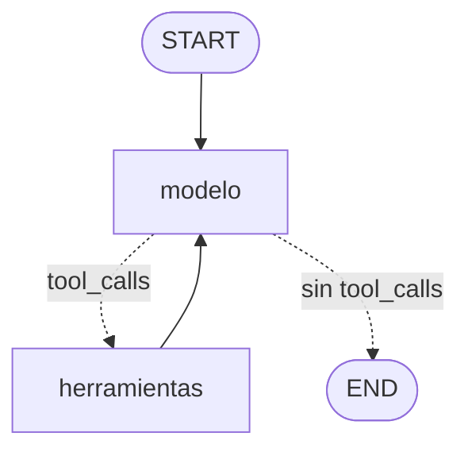

# Pre-Entrega 5 — Agente ReAct con Memoria Persistente

**AI Engineering — Coderhouse**

Asesor virtual de una concesionaria Volkswagen construido con **LangGraph**.
El agente decide por sí mismo cuándo consultar herramientas, encadena varias
consultas para llegar a una respuesta (ciclo ReAct), se recupera de errores
de las herramientas y recuerda la conversación entre ejecuciones gracias a
un checkpointer en **SQLite**.

Continúa el dataset de las entregas anteriores: los modelos y sus datos
técnicos (Tera, Polo, Virtus, Nivus, Taos, Vento y Saveiro) son los mismos
que se indexaron en las Pre-Entregas 3 y 4.

## 1. Resumen

| Aspecto | Detalle |
|---|---|
| Framework | LangGraph (`StateGraph` + `ToolNode` + `tools_condition`) |
| Estado | `EstadoAgente`, que hereda de `MessagesState` (reducer `add_messages`) |
| Herramientas | `buscar_versiones` y `consultar_stock`, con `@tool` y esquemas Pydantic |
| LLM | OpenAI, Anthropic, Gemini u Ollama (local), vinculado con `llm.bind_tools()` |
| Persistencia | `AsyncSqliteSaver` (variante asíncrona de `SqliteSaver`) + `thread_id` |
| Límite de pasos | `recursion_limit = 10` (configurable) |
| Fallas del LLM | `RetryPolicy` en el nodo modelo: reintenta errores transitorios (503, rate limit) |
| Python | 3.12, con type hints y `asyncio` |
| Tests | 15 tests con `pytest`, sin API key |
| Traza | `trazas/traza_ejecucion.json` y `.log`, generadas con `gpt-4o-mini` (5 de 5 escenarios OK) |

## 2. Arquitectura



*(Diagrama generado con `get_graph().draw_mermaid()` a partir del grafo compilado.)*

- **`modelo`** (Reason): el LLM recibe el historial y decide si necesita una
  herramienta (devuelve `tool_calls`) o si ya puede responder.
- **`tools_condition`**: arista condicional predefinida de LangGraph. Mira el
  último mensaje: si trae `tool_calls`, va a `herramientas`; si no, a `END`.
  No hay rutas manuales `if/else`: decide el LLM.
- **`herramientas`** (Act + Observe): un `ToolNode` ejecuta las herramientas
  pedidas y agrega sus resultados al historial.
- **`herramientas → modelo`**: la arista que cierra el **ciclo**. El LLM ve el
  resultado y puede pedir otra herramienta (razonamiento multi-paso) o
  responder.
- **Checkpointer**: después de cada nodo guarda una "fotografía" del estado en
  `checkpoints.sqlite`, asociada al `thread_id` de la conversación.

### Estructura de archivos

| Archivo | Responsabilidad |
|---|---|
| `agente/catalogo.py` | "Base de datos" simulada: versiones (datos reales) y stock (ficticio) |
| `agente/tools.py` | Herramientas `@tool` con esquemas Pydantic y docstrings descriptivos |
| `agente/grafo.py` | `EstadoAgente`, nodos, aristas, prompt de sistema y recorte de contexto |
| `agente/llm.py` | Selección del proveedor de LLM y validación de `TEMPERATURE` |
| `agente/sesion.py` | Checkpointer SQLite, ejecución de turnos y armado de la traza ReAct |
| `agente/config.py` | Configuración leída del `.env` |
| `demo.py` | Corrida de demostración: un escenario por criterio de aceptación |
| `main.py` | Chat interactivo con `thread_id` configurable |
| `tests/test_agente.py` | Tests sin API key, con un LLM simulado |
| `trazas/` | Traza ReAct de la última corrida de `demo.py` |

## 3. Cómo levantar el entorno

Requiere **Python 3.12**.

```bash
py -3.12 -m venv venv              # Windows; en Linux/Mac: python3.12 -m venv venv
source venv/Scripts/activate       # Git Bash; en Linux/Mac: source venv/bin/activate
python --version                   # tiene que decir 3.12.x: si no, el venv no está activado
python -m pip install -r requirements.txt
cp .env.example .env
```

En el `.env`, configurar **un** proveedor de LLM:

| Proveedor | Configuración | Modelo por defecto | Comentario |
|---|---|---|---|
| OpenAI | `OPENAI_API_KEY` | `gpt-4o-mini` | Pago; la demo completa cuesta menos de un centavo de dólar |
| Anthropic | `ANTHROPIC_API_KEY` | `claude-sonnet-4-6` | Pago |
| Gemini | `GEMINI_API_KEY` | `gemini-flash-latest` | Capa gratuita ([aistudio.google.com/apikey](https://aistudio.google.com/apikey)), con un límite de pedidos por día |
| Ollama | `LLM_PROVIDER=ollama` | `llama3.2` | Local y gratuito, sin key. Requiere [Ollama](https://ollama.com) abierto y `ollama pull llama3.2` |

Si `LLM_PROVIDER` está vacío, se usa la primera key cargada (en el orden
OpenAI, Anthropic, Gemini). **Ollama nunca se elige automáticamente**: como no
necesita key, siempre "estaría disponible", así que hay que pedirlo con
`LLM_PROVIDER=ollama`. Sirve para practicar con `main.py` sin gastar cuota,
pero los modelos locales chicos eligen herramientas peor que los de la nube:
la traza que se entrega conviene generarla con OpenAI, Anthropic o Gemini.

## 4. Uso

```bash
python -m pytest -v        # tests de la mecánica del agente (no usan API key)
python demo.py             # corrida de demostración: genera la traza en trazas/
python demo.py --desde 3   # retomar una corrida cortada, desde el escenario 3
python main.py             # chat interactivo (thread "sesion-usuario")
python main.py --thread X  # retomar o empezar la conversación con thread_id X
```

`demo.py` hace entre 12 y 15 llamadas al LLM. Con la capa gratuita de Gemini,
que tiene un límite de pedidos por día, conviene no correrla muchas veces
seguidas. Si el proveedor corta a mitad de camino (por ejemplo, se agota la
cuota diaria), no se pierde nada: la traza se guarda después de cada escenario
y la corrida se retoma con `--desde N`, como indica el propio mensaje de error.

## 5. El dominio: la concesionaria simulada

La consigna pide una herramienta que simule una base de datos. `agente/catalogo.py`
tiene dos "tablas":

- **Versiones** (15 versiones de 7 modelos): motor, potencia, torque y caja.
  Son **datos reales**, tomados del dataset verificado de las entregas
  anteriores.
- **Stock** por versión y sucursal (Palermo, Belgrano, Córdoba, Rosario): son
  **datos ficticios** de una concesionaria de demostración.

Están separadas a propósito, con la misma idea que la notebook de la clase: el
stock se consulta por `version_id`, un código que el usuario no conoce. Para
responder "¿hay Tera automático en Palermo?", el agente tiene que razonar en
pasos por su cuenta: buscar las versiones del Tera, filtrar las automáticas y
consultar el stock de cada una.

## 6. Criterios de aceptación

### 6.1 Autonomía

Ninguna ruta del grafo está escrita a mano: `tools_condition` deriva el flujo
según si el LLM pidió herramientas. Qué herramienta usar, con qué argumentos y
en qué orden lo decide el LLM leyendo los **docstrings** de cada herramienta,
que describen qué devuelve cada una, cuándo usarla y que `consultar_stock`
necesita el `version_id` de `buscar_versiones` (el error a evitar
"Descripciones Vagas").

### 6.2 Ciclo de retorno

Dos tipos de error, con dos reacciones distintas:

- **Error temporal → reintento.** El "sistema de stock" de la sucursal Córdoba
  simula ser inestable: su primera consulta lanza un `TimeoutError`, como haría
  un cliente HTTP real. `ToolNode(handle_tool_errors=True)` convierte la
  excepción en un mensaje para el LLM en lugar de cortar el programa, y el
  agente reintenta la consulta.
- **Dato inexistente → aclaración.** Si el usuario pregunta por un modelo que
  no está en el catálogo (por ejemplo, la Amarok), la herramienta devuelve un
  texto `ERROR: ...` con los modelos válidos, y el agente se lo explica al
  usuario y le pide que elija otro, en lugar de inventar una respuesta.

El prompt de sistema distingue explícitamente los dos casos.

### 6.3 Resiliencia de estado

`AsyncSqliteSaver` guarda el estado en `checkpoints.sqlite` después de cada
nodo. Con el mismo `thread_id`, el agente retoma la conversación: en la demo,
"¿Y en Belgrano?" solo tiene sentido recordando la pregunta anterior sobre el
Tera. Además, el escenario 5 cierra la conexión y abre una nueva (simula
reiniciar el programa): todo lo que el agente sabe de la conversación sale
del archivo SQLite. Threads distintos no comparten historial.

Se usa `AsyncSqliteSaver` en lugar de `SqliteSaver` porque todo el agente es
asíncrono: es la variante para `asyncio` del mismo checkpointer (mismo paquete,
`langgraph-checkpoint-sqlite`, y mismo formato de archivo).

La persistencia también hace que la demo se pueda **retomar**: si una corrida
se corta después del escenario 2, `python demo.py --desde 3` continúa en otro
proceso, incluso otro día. El escenario 5 ("¿qué motor tienen las versiones
automáticas que me dijiste?") funciona igual, porque el historial de los
escenarios 1 y 2 sigue en `checkpoints.sqlite`.

### 6.4 Código limpio

Python 3.12, type hints en todas las funciones, `asyncio` de punta a punta
(herramientas `async`, `ainvoke`, checkpointer asíncrono) y modelos Pydantic
para los argumentos de las herramientas y para la traza.

### 6.5 Resiliencia ante fallas del LLM (extra)

El ciclo de retorno anterior cubre los errores de las **herramientas**, que
resuelve el propio LLM. Pero el LLM también puede fallar: en la primera
corrida real de la demo, Gemini respondió `503 UNAVAILABLE` ("alta demanda,
probá más tarde") a mitad de la ejecución. Por eso el nodo `modelo` tiene una
`RetryPolicy` de LangGraph: hasta 4 intentos, con esperas crecientes de ~2, 4
y 8 segundos, solo para errores transitorios (`ModelAPIError`, rate limit,
timeout, conexión). Una API key inválida o un modelo mal escrito no se
reintentan, porque no se arreglan solos.

Tampoco se reintenta un 429 por **cuota diaria** agotada (por ejemplo, el
límite de pedidos por día de la capa gratuita de Gemini): es el mismo código
de error que el límite por minuto, pero no se libera hasta dentro de horas, así
que `es_error_transitorio()` lo distingue por el mensaje y corta enseguida. En
ese caso, `demo.py` y `main.py` muestran un mensaje claro con las opciones
(esperar, cambiar de modelo o de proveedor) en lugar de un traceback. Lo
mismo con Ollama: si no está abierto o le falta el modelo, se explica cómo
resolverlo.

## 7. Errores a evitar

| Error | Cómo se evita |
|---|---|
| Descripciones vagas | Docstrings que dicen qué devuelve cada herramienta, cuándo usarla y en qué orden (`agente/tools.py`) |
| Bucles infinitos | `recursion_limit=10` en cada invocación. Si se alcanza, el turno termina con un mensaje claro en vez de romper (`agente/sesion.py`) |
| Estado sucio | El historial completo se conserva en SQLite, pero al LLM le llegan solo los últimos `MAX_MENSAJES_CONTEXTO` mensajes, recortados con `trim_messages` empezando siempre por un mensaje del usuario para no separar una herramienta de su resultado (`agente/grafo.py`) |
| API keys en el repo | Variables de entorno; `.env` está en `.gitignore` |
| No probar el camino de fallo | Timeout simulado en Córdoba, modelo inexistente y bucle infinito: cubiertos por la demo y por los tests |
| Olvidar el reducer | `EstadoAgente` hereda `messages` con `add_messages` de `MessagesState` |
| Cargar el estado con infraestructura | El LLM y el checkpointer viven fuera del estado; el estado solo tiene los mensajes |

## 8. Tests

`tests/test_agente.py` usa un LLM "guionado" que devuelve respuestas fijas
(incluidas las `tool_calls`), así que corre sin API key y siempre da el mismo
resultado. Verifica la **mecánica** del agente:

1. Razonamiento multi-paso: encadena herramientas y responde.
2. Reintento ante el timeout de Córdoba.
3. Un dato inexistente vuelve al LLM como error, sin romper.
4. La memoria persiste en SQLite al reconectar, y los threads no se mezclan.
5. `recursion_limit` corta un agente que nunca termina.
6. El recorte de contexto respeta el límite y empieza en un mensaje del usuario.
7. Las herramientas normalizan mayúsculas, tildes y el prefijo "VW".
8. Un `checkpoints.sqlite` nuevo permite borrar threads (bug encontrado al
   probar la demo: las tablas no existían hasta el primer guardado).
9. Un error 503 del proveedor del LLM se reintenta y el turno termina bien.
10. Una API key inválida falla de inmediato, sin reintentos inútiles.
11. Un 429 por cuota diaria agotada tampoco se reintenta.
12. Un 429 común (límite por minuto) sí se reintenta.
13. Ollama nunca se elige automáticamente, solo con `LLM_PROVIDER=ollama`.
14. Los clientes de Ollama y OpenAI se construyen y aceptan `bind_tools()`
    (los dos proveedores que no se pueden probar sin servidor local o crédito).
15. Con Ollama apagado, el error se reconoce y se informa con un mensaje claro.

Que el LLM real **razone** bien se demuestra aparte, con la traza de `demo.py`.

## 9. Traza de ejecución

`python demo.py` corre cinco escenarios y guarda la traza en
`trazas/traza_ejecucion.json` (estructurada) y `trazas/traza_ejecucion.log`
(legible). Cada escenario registra qué LLM lo respondió y cuándo:

| # | Escenario | Criterio |
|---|---|---|
| 1 | "¿Hay stock del Tera con caja automática en la sucursal Palermo?" | Razonamiento multi-paso |
| 2 | "¿Y en Belgrano?" (mismo thread) | Memoria en la sesión |
| 3 | "¿Tienen la Saveiro Extreme en la sucursal Córdoba?" | Reintento ante timeout |
| 4 | "¿Cuántas Amarok tienen en stock?" | Aclaración ante dato inexistente |
| 5 | Pregunta de seguimiento tras reconectar | Persistencia en SQLite |

### Resultados de la corrida con `gpt-4o-mini`

| # | Qué hizo el agente | Llamadas a herramientas | Resultado |
|---|---|---|---|
| 1 | Buscó las versiones del Tera, filtró solo las 3 automáticas y consultó el stock de cada una en Palermo | 4 | ✅ Respuesta correcta |
| 2 | Con "¿Y en Belgrano?", reutilizó los 3 `version_id` del turno anterior sin volver a buscarlos | 3 | ✅ Recordó el contexto |
| 3 | Recibió el `TimeoutError` de Córdoba, reintentó la misma consulta y obtuvo el dato | 3 | ✅ Se recuperó del error |
| 4 | Recibió el error de la Amarok y ofreció los modelos válidos, sin inventar | 1 | ✅ Pidió aclaración |
| 5 | Tras reconectar, respondió los motores solo con el historial guardado en SQLite | 0 | ✅ Memoria persistente |

El escenario 5 es la prueba más directa de la persistencia: el agente no volvió
a consultar ninguna herramienta, porque los datos del primer turno estaban en
el checkpoint.

### Escenario 1: razonamiento multi-paso

(La salida de `buscar_versiones` está abreviada; la completa está en
`trazas/traza_ejecucion.log`.)

```
Usuario: "¿Hay stock del Tera con caja automática en la sucursal Palermo?"   [thread_id=demo-stock-tera]
→ El agente decide usar la herramienta: buscar_versiones(modelo='Tera')
→ La herramienta devuelve: [{"version_id": "TERA-TREND-MT5", ..., "automatica": false},
   {"version_id": "TERA-COMFORT-AT6", ..., "automatica": true}, {"version_id": "TERA-HIGH-AT6", ...,
   "automatica": true}, {"version_id": "TERA-OUTFIT-AT6", ..., "automatica": true}]
→ El agente decide usar la herramienta: consultar_stock(version_id='TERA-COMFORT-AT6', sucursal='Palermo')
→ El agente decide usar la herramienta: consultar_stock(version_id='TERA-HIGH-AT6', sucursal='Palermo')
→ El agente decide usar la herramienta: consultar_stock(version_id='TERA-OUTFIT-AT6', sucursal='Palermo')
→ La herramienta devuelve: {"version_id": "TERA-COMFORT-AT6", "sucursal": "Palermo", "unidades": 0}
→ La herramienta devuelve: {"version_id": "TERA-HIGH-AT6", "sucursal": "Palermo", "unidades": 2}
→ La herramienta devuelve: {"version_id": "TERA-OUTFIT-AT6", "sucursal": "Palermo", "unidades": 1}
Respuesta: "En la sucursal Palermo hay stock del Tera con caja automática en las siguientes versiones:
- Tera High 170 TSI AT6: 2 unidades disponibles.
- Tera Outfit 170 TSI AT6: 1 unidad disponible.
La versión Tera Comfort 170 TSI AT6 no tiene stock. [...]"
(llamadas a herramientas en este turno: 4)
```

### Escenario 3: ciclo de retorno ante un timeout

```
Usuario: "¿Tienen la Saveiro Extreme en la sucursal Córdoba?"   [thread_id=demo-saveiro-cordoba]
→ El agente decide usar la herramienta: buscar_versiones(modelo='Saveiro')
→ La herramienta devuelve: [... 3 versiones de la Saveiro, entre ellas SAVEIRO-EXTREME-CD ...]
→ El agente decide usar la herramienta: consultar_stock(version_id='SAVEIRO-EXTREME-CD', sucursal='Córdoba')
→ La herramienta devuelve [ERROR]: Error: TimeoutError('El sistema de stock de la sucursal Córdoba no respondió a tiempo (timeout simulado).')
→ El agente decide usar la herramienta: consultar_stock(version_id='SAVEIRO-EXTREME-CD', sucursal='Córdoba')
→ La herramienta devuelve: {"version_id": "SAVEIRO-EXTREME-CD", "sucursal": "Córdoba", "unidades": 2}
Respuesta: "Sí, tenemos la Saveiro Extreme cabina doble en la sucursal Córdoba. Hay 2 unidades disponibles."
(llamadas a herramientas en este turno: 3)
```

Checkpoints guardados en SQLite al final de la corrida: 15 en `demo-stock-tera`,
9 en `demo-saveiro-cordoba` y 5 en `demo-modelo-inexistente`.

## 10. Cumplimiento de la consigna

| Requisito | Dónde |
|---|---|
| Proyecto Python 3.12+ con venv | Sección 3, `requirements.txt` |
| `StateGraph` que hereda de `MessagesState` | `agente/grafo.py` (`EstadoAgente`) |
| Nodo modelo + nodo herramientas + `tools_condition` | `agente/grafo.py` (`construir_grafo`) |
| Al menos una herramienta propia con `@tool` y docstring | `agente/tools.py` (dos herramientas) |
| LLM vinculado con `llm.bind_tools()` | `agente/grafo.py` |
| Persistencia con SQLite + `thread_id` | `agente/sesion.py` (`abrir_agente`) |
| Razonamiento multi-paso (herramienta ≥ 2 veces) | `demo.py`, escenario 1 |
| `recursion_limit` definido | `agente/config.py`, `agente/sesion.py` |
| Traza de ejecución (.json o log) | `trazas/` |
| README con cómo levantar el entorno | Sección 3 |
| Sin API keys en el repo | `.env.example`, `.gitignore` |
